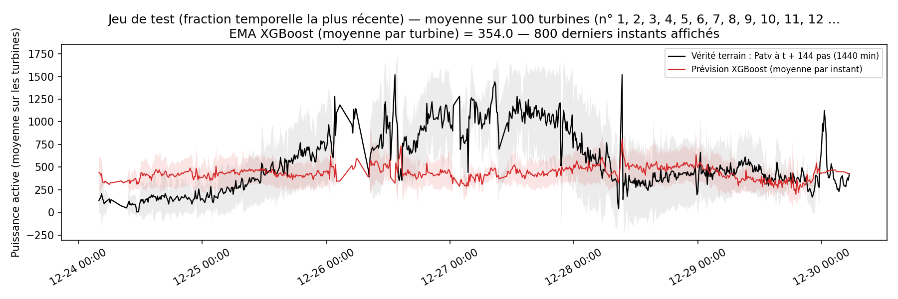

# Prévision de production éolienne (SDWPF)

[](https://github.com/Airohh/sdwpf-ml-time-serie/actions/workflows/ci.yml)
[](LICENSE)

Question : avec la météo réanalysée (ERA5) et le calendrier seulement, sans la puissance récente ni le vent mesuré par la turbine, peut-on prévoir la production d’une éolienne à J+1 ?

Données SDWPF (parc éolien chinois, SCADA toutes les 10 min + ERA5). Cible : `Patv` (kW) 144 pas plus tard, soit 24 h. Un XGBoost par turbine (ou un modèle commun avec `--pooled`), split temporel, 30 % les plus récents en test.

## Résultat

> **Chiffres à régénérer (v0.2).** Le tableau ci-dessous vient de la v0.1 du pipeline, qui avait trois défauts corrigés depuis :
> la cible était décalée **par ligne** (après nettoyage et jointure ERA5, la cible « J+1 » pouvait tomber plusieurs jours plus loin),
> des mesures valides étaient supprimées (`Patv < 0` à l’arrêt, `Wdir < 0` alors que c’est un angle dans [-180, 180]),
> et le jour de l’année servait de feature sur 245 jours de données (horodatage déguisé, top des importances).
> Relancer `python scripts/reproduce_meteo_figures.py --preset all` puis mettre à jour ce tableau et `reports/figures/`.

MAE sur le test (v0.1), en kW. Naive = moyenne de `Patv` sur le train.

| Turbines | Naive | XGBoost | Écart |
|----------|-------|---------|-------|
| 1 | 434.1 | 530.6 | −22.2 % |
| 20 (n° 1–20) | 378.5 | 380.6 | −0.5 % |
| 100 (n° 1–100) | 346.2 | 354.0 | −2.2 % |



En v0.1, la prévision reste entre 300 et 600 kW pendant que la production monte au-delà de 1 000 kW : le modèle apprend le niveau moyen, pas les épisodes de vent.

Ce que la v0.2 permet de trancher :

- **Désalignement ou absence de signal ?** Le mode météo n’utilise que ERA5 à l’instant *t* (et 2 h de retards) pour prédire *t* + 24 h. `--era5-at-target` ajoute ERA5 **à l’échéance**, comme une prévision météo parfaite : c’est le plafond de ce que de vraies prévisions apporteraient, à comparer à la baseline courbe de puissance.
- **Battre une moyenne ne suffit pas.** La climatologie horaire (moyenne train par heure de l’échéance) est maintenant calculée partout ; avec ERA5 à l’échéance, la courbe de puissance empirique aussi.
- La persistance (`Patv(t)` pour prédire `Patv(t+h)`) n’est affichée que si `Patv(t)` est une feature : sinon la baseline aurait accès à une donnée que le modèle n’a pas.

Toutes les figures : `reports/figures/` (01 séries, 02 vent/puissance, 03 prévision, 04 importances, 05–06 métriques par turbine).

## Données

- **Chine (SDWPF)**, le cœur du projet. SCADA + ERA5, à placer sous `data/china/sdwpf/` (non versionné, trop lourd). Détail dans [`docs/GUIDE.md`](docs/GUIDE.md).
- **France** : production ODRE + météo Open-Meteo (`data/france/`). La production est nationale et la météo est prise en un point : pas de couple turbine + météo sur le même site.
- **USA** : Wind Toolkit (NLR). `scripts/download_wind_toolkit_nlr.py` demande `NLR_API_KEY` et `NLR_EMAIL` dans un `.env` (voir `.env.example`).

## Lancer

```bash
git clone https://github.com/Airohh/sdwpf-ml-time-serie.git
cd sdwpf-ml-time-serie
pip install -c requirements-lock.txt -e ".[dev]"   # versions validées ; ".[dev,experiments]" pour MLflow

pytest -q        # tests unitaires + chaque script sur un faux SDWPF
ruff check .
```

Avec les données SDWPF en place :

```bash
python scripts/reproduce_meteo_figures.py --preset multi20         # ou single, multi5, multi100, all
python scripts/sdwpf_explore.py --meteo-mode                       # une turbine, J+1, métriques + importances
python scripts/sdwpf_explore.py --meteo-mode --era5-at-target      # plafond : ERA5 à l'échéance
python scripts/sdwpf_explore.py --meteo-mode --pooled 1-20         # un modèle pour 20 turbines
python scripts/sdwpf_benchmark.py --meteo-mode                     # plusieurs horizons, CSV + Markdown
python scripts/sdwpf_walkforward.py --meteo-mode --n-splits 3 --test-size 5000
```

Options communes : `--xgb-objective reg:absoluteerror` (optimise la MAE), `--day-of-year`, `--xgb-device cuda` (CPU par défaut). Détail : [`docs/GUIDE.md`](docs/GUIDE.md).

Docker (bash ou PowerShell) :

```bash
docker build -t sdwpf-forecast .
docker run --rm -v "${PWD}/data:/app/data" -v "${PWD}/reports:/app/reports" sdwpf-forecast python scripts/sdwpf_explore.py --meteo-mode
```

## Évaluation

- Split temporel, jamais aléatoire. `--val-frac` ajoute une validation (train | val | test) pour l’early stopping ; le score final est toujours sur le test.
- Lags et cible lus **sur le temps** (`t ± k × 10 min`) : un instant manquant donne une valeur manquante, jamais la ligne suivante.
- Purge : les lignes du train (et de la validation) dont la cible `t+h` tombe dans le bloc suivant sont retirées.
- Baselines : naive (moyenne train), climatologie horaire, courbe de puissance (avec `--era5-at-target`), persistance (si `Patv(t)` est une feature).
- Walk-forward : `scripts/sdwpf_walkforward.py`, moyenne et écart-type des MAE sur plusieurs plis en fin de série.

## Limites et suite

- Un seul parc. Les chiffres v0.2 restent à produire sur les vraies données, puis à confirmer en walk-forward.
- ERA5 est une réanalyse, pas une prévision : `--era5-at-target` donne un plafond, pas un modèle déployable. En production, il faudrait la météo prévue à l’échéance.
- Suite : réintroduire le vent SCADA et la puissance récente là où c’est permis, puis passer à des prévisions en quantiles.

## Docs

- [`docs/GUIDE.md`](docs/GUIDE.md) : parcours complet, glossaire SCADA / ERA5, toutes les options CLI.
- [`docs/DOMAINE_ET_PRATIQUES.md`](docs/DOMAINE_ET_PRATIQUES.md) : domaine métier et checklist anti-fuite.

Licence [MIT](LICENSE).
